<p align="center">
  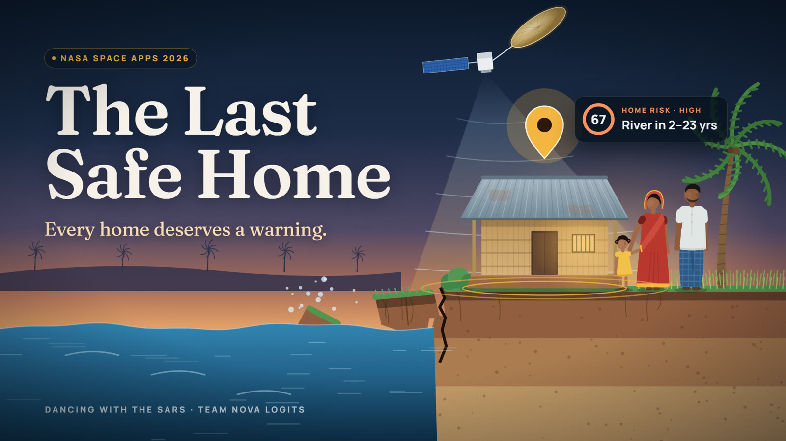
</p>

<h1 align="center">The Last Safe Home</h1>

<p align="center">
  <b>Every home deserves a warning before it becomes a memory.</b><br>
  River-bank erosion and flood risk for coastal Bangladesh, from NASA–ISRO <b>NISAR</b> radar.
</p>

<p align="center">
  
  
  
  
  
</p>

<p align="center">
  <a href="#the-challenge">Challenge</a> ·
  <a href="#the-problem">Problem</a> ·
  <a href="#what-it-does">Solution</a> ·
  <a href="#the-film-in-eight-frames">Film</a> ·
  <a href="#how-it-works">How it works</a> ·
  <a href="#data">Data</a> ·
  <a href="#quick-start">Quick start</a> ·
  <a href="#limitations">Limitations</a> ·
  <a href="#team">Team</a>
</p>

<p align="center">
  <a href="https://www.youtube.com/watch?v=bHoLkvEUmAI"></a>
  &nbsp;
  <a href="https://www.youtube.com/watch?v=I6KFL4Epd8w"></a>
</p>

<!-- TODO: add the live demo URL in the table below. -->

| | |
|---|---|
| **Videos** | [Full film (4 min)](https://www.youtube.com/watch?v=bHoLkvEUmAI) · [30-second summary](https://www.youtube.com/watch?v=I6KFL4Epd8w) |
| **Event** | NASA International Space Apps Challenge 2026 · Khulna local event |
| **Challenge** | *Dancing with the SARs* |
| **Data** | NISAR (NASA–ISRO) L-band radar · Landsat · Sentinel-2 · OpenStreetMap · WorldPop · geoBoundaries |
| **Sites** | Manpura Island (Bhola) · Koyra (Khulna) · synthetic demo |
| **Try it** | `make demo && make api && make web` · see [Quick start](#quick-start) |

---

## The challenge

<p align="center">
  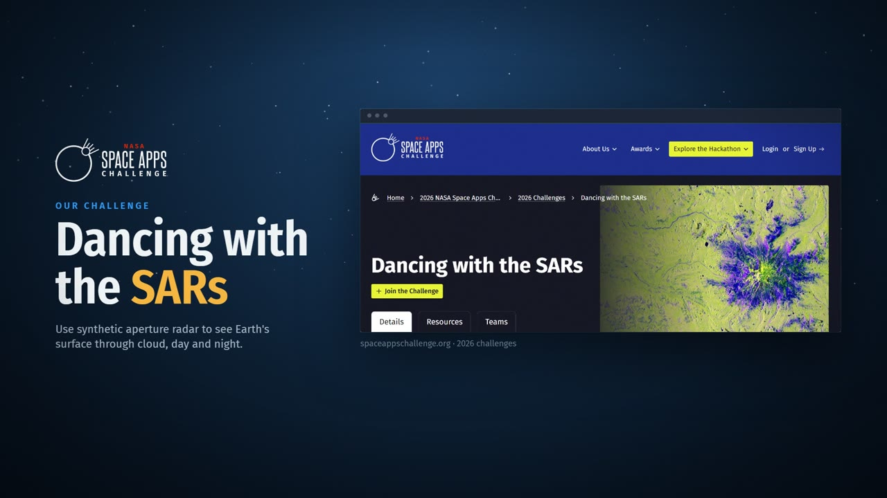
</p>

*Dancing with the SARs* asks teams to use synthetic aperture radar to see Earth's surface through cloud, day and
night. We used the new NISAR mission to answer one human question: **how long until the river reaches my home?**

## The problem

In most countries an address is permanent. In the **chars of Bangladesh**, even an address can have an expiry date.
Monpura Island covered about **148 km² in 1973** and around **114 km² by 2010**. The rivers are swallowing homes,
farmland and livelihoods, and families face the same question again and again: *rebuild, or move?*

For many of them that decision is still made on **instinct, not data**. Optical satellites are blind under monsoon
cloud, engineering surveys rarely reach remote chars, and the data that does exist in space rarely reaches the
people who need it.

## What it does

**The Last Safe Home** turns NISAR radar (which sees through cloud, day and night) and 38 years of Landsat images
into three plain answers for any point on the map:

| | Question | Answer |
|---|---|---|
| **1** | Where is the river bank today? | Distance from this home to today's bank line |
| **2** | How fast is it moving? | Bank retreat rate since 1988, with its uncertainty |
| **3** | What does that mean for someone's home? | A **Home Risk Score (0–100)** and the **range of years until the river arrives** |

<p align="center">
  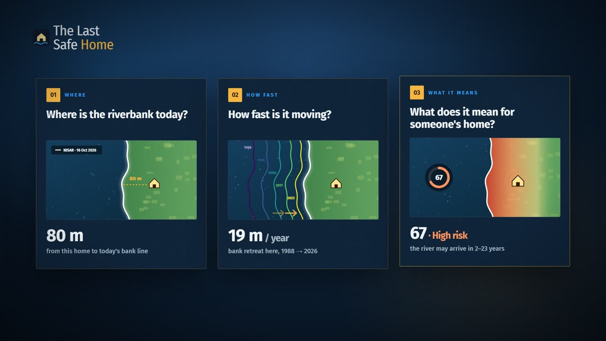
</p>

> Every number is an estimate from satellite data, not an engineering survey. Use it to start a conversation with
> local authorities.

### Highlights

- **Click a point** → score, years until the river arrives, distance to the bank, retreat rate, flood frequency
- **Draw an area** → land lost, buildings and people by risk class, NISAR scenes over it, GeoJSON download
- **Radar time slider** → step through the 2026 NISAR passes, through monsoon cloud
- **1988 vs today** → swipe between the old Landsat shoreline and the latest NISAR shoreline
- **One-page report** → print or save as PDF for the union parishad
- **English and Bangla**, and a phone layout for use on the bank itself
- **Two real sites**: Manpura Island (Bhola) and Koyra (Khulna), plus a synthetic demo site that needs no downloads

<table>
  <tr>
    <td width="50%">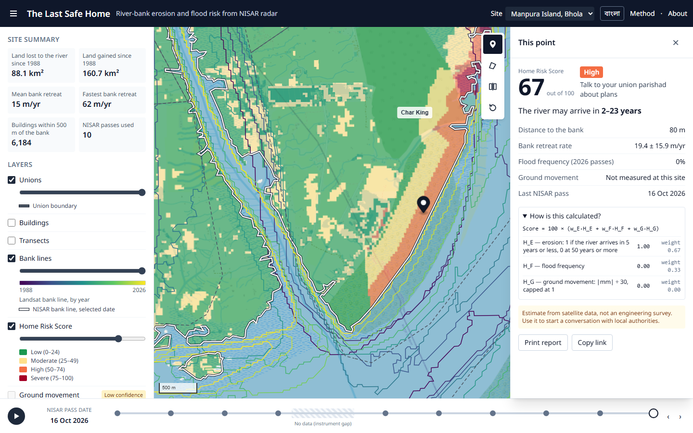<br><sub><b>Point card</b> · “When could the river reach this house?”</sub></td>
    <td width="50%">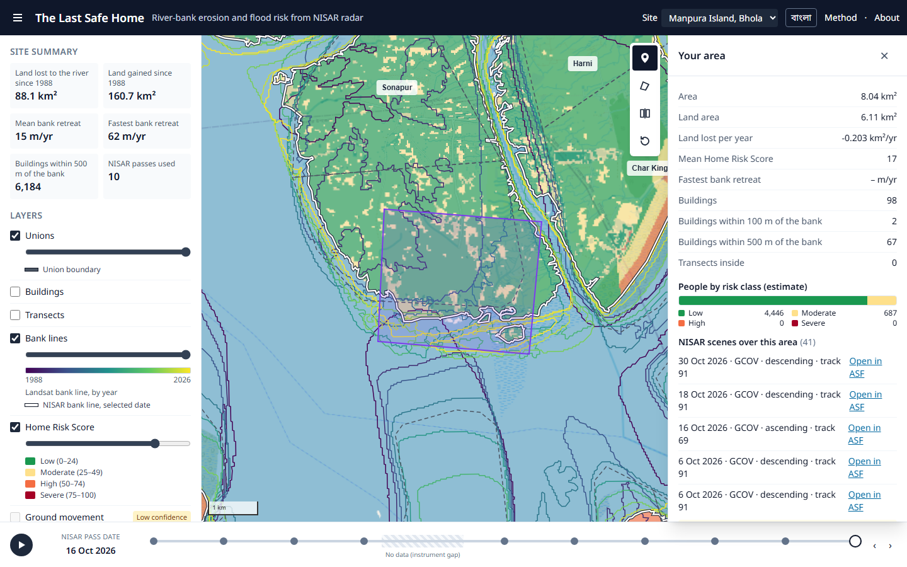<br><sub><b>Draw an area</b> · land lost, buildings, people by risk class</sub></td>
  </tr>
  <tr>
    <td>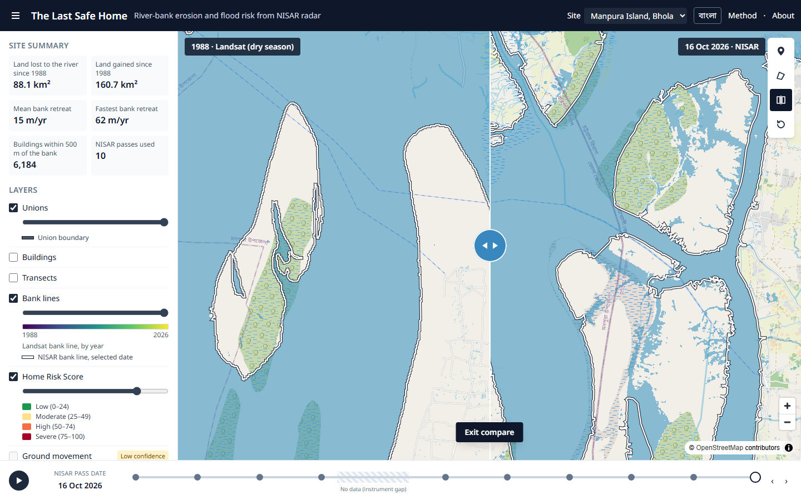<br><sub><b>1988 vs today</b> · decades of land loss in one swipe</sub></td>
    <td>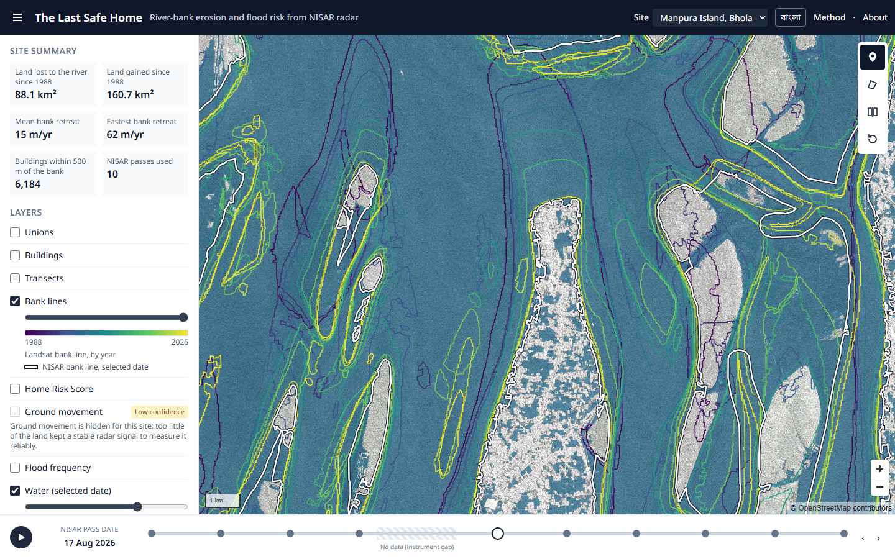<br><sub><b>Radar time slider</b> · every 2026 NISAR pass</sub></td>
  </tr>
</table>

All 16 screenshots, each with who uses it in real life: **[docs/FEATURES.md](docs/FEATURES.md)**.

## The film in eight frames

The team's submission film ([4 min](https://www.youtube.com/watch?v=bHoLkvEUmAI)) and its
[30-second summary](https://www.youtube.com/watch?v=I6KFL4Epd8w) tell the story from the char to the product.
Frames from the film:

<table>
  <tr>
    <td width="50%">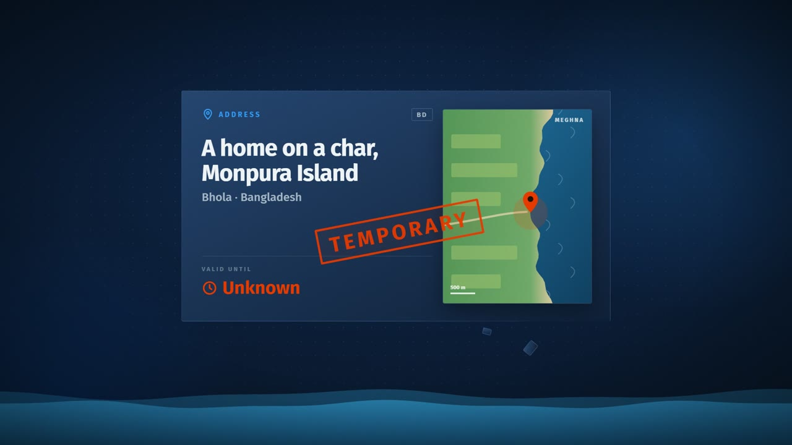<br><sub><b>1 · The hook</b> · an address with an expiry date</sub></td>
    <td width="50%">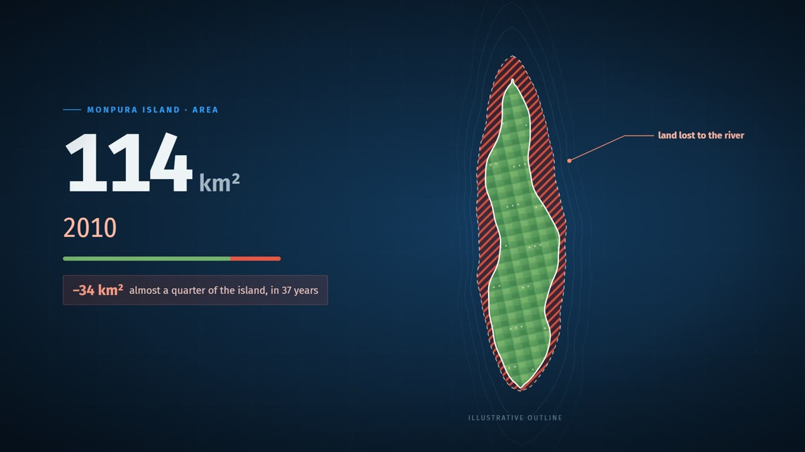<br><sub><b>2 · The loss</b> · 148 → 114 km² in 37 years</sub></td>
  </tr>
  <tr>
    <td>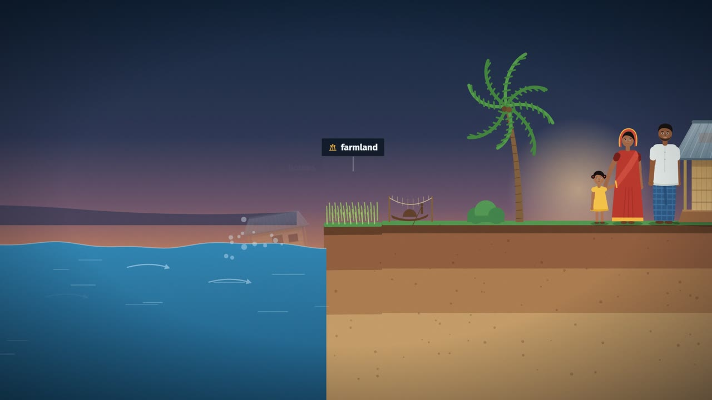<br><sub><b>3 · The people</b> · homes, farmland, livelihoods</sub></td>
    <td>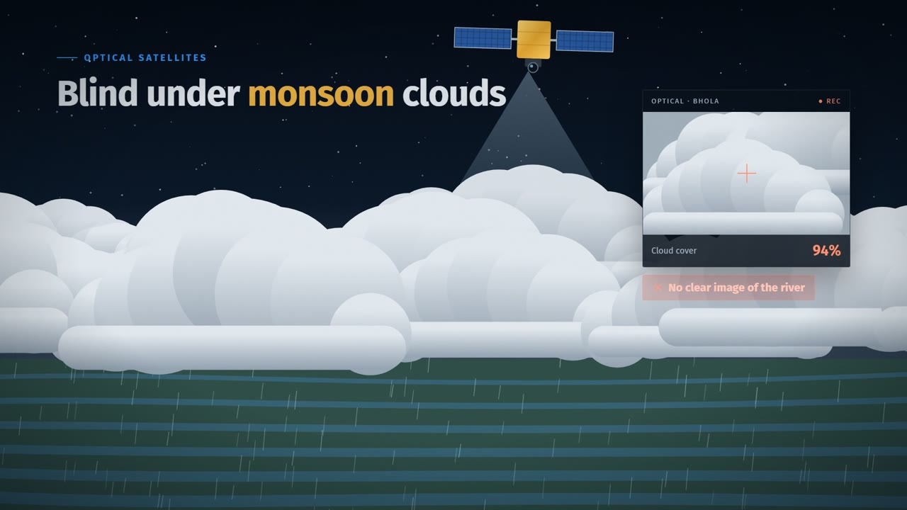<br><sub><b>4 · The gap</b> · optical satellites are blind under cloud</sub></td>
  </tr>
  <tr>
    <td>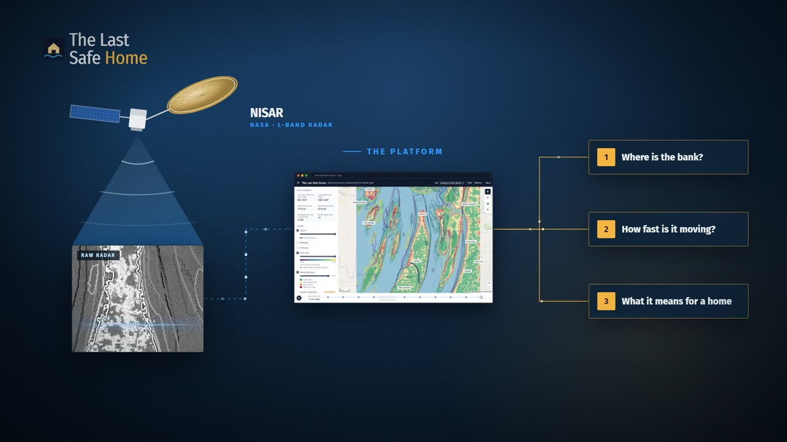<br><sub><b>5 · The solution</b> · NISAR radar → three answers</sub></td>
    <td>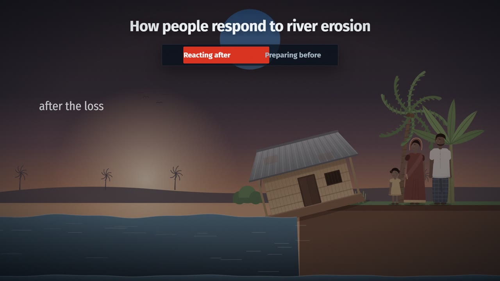<br><sub><b>6 · The change</b> · from reacting to preparing</sub></td>
  </tr>
  <tr>
    <td><br><sub><b>7 · Next step</b> · early warning on every phone</sub></td>
    <td>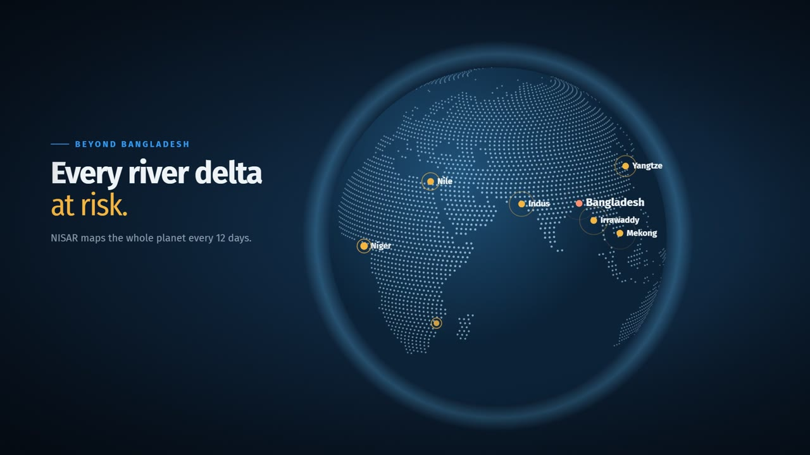<br><sub><b>8 · Beyond Bangladesh</b> · every river delta at risk</sub></td>
  </tr>
</table>

## How it works

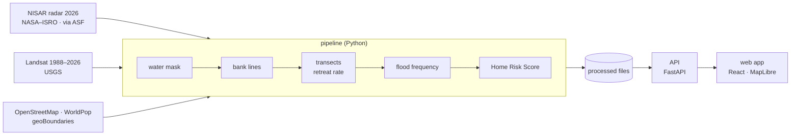

1. **Where is the water?** NISAR HH backscatter is classified into water and land for each 2026 pass; Landsat gives the shoreline for each year since 1988.
2. **Where is the bank, and how fast does it move?** A bank line per year, then transects every 100 m give the retreat rate and its uncertainty.
3. **How often does it flood?** The share of 2026 passes in which a place was under water.
4. **Home Risk Score.** For any land point, with *D* the distance to today's bank, *R ± σ* the retreat rate, *F* the flood frequency and *M* the ground movement:
   - years until the river arrives **T = D ÷ R**, as a range using R ± σ (over 50 years is shown as “over 50 years”)
   - **Score = 100 × (0.6·H<sub>E</sub> + 0.3·H<sub>F</sub> + 0.1·H<sub>G</sub>)**, where H<sub>E</sub> is the erosion hazard (1 if the river may arrive within 5 years, 0 at 50 years or more), H<sub>F</sub> the flood frequency and H<sub>G</sub> the ground movement. If radar cannot measure ground movement at a site, its weight goes to the other two.

| Score | Class | Advice shown |
|---|---|---|
| 0–24 | Low | No sign of fast change here |
| 25–49 | Moderate | Watch this area each monsoon |
| 50–74 | High | Talk to your union parishad about plans |
| 75–100 | Severe | The river may reach here within a few years |

The same code computes the map colours and the numbers in the click card, so they always agree. The full method in
plain words is in **[docs/METHOD.md](docs/METHOD.md)** (Bangla: [docs/METHOD.bn.md](docs/METHOD.bn.md)) and is also
shown live in the app at `/method`, with the site's validation numbers.

## Data

<p align="center">
  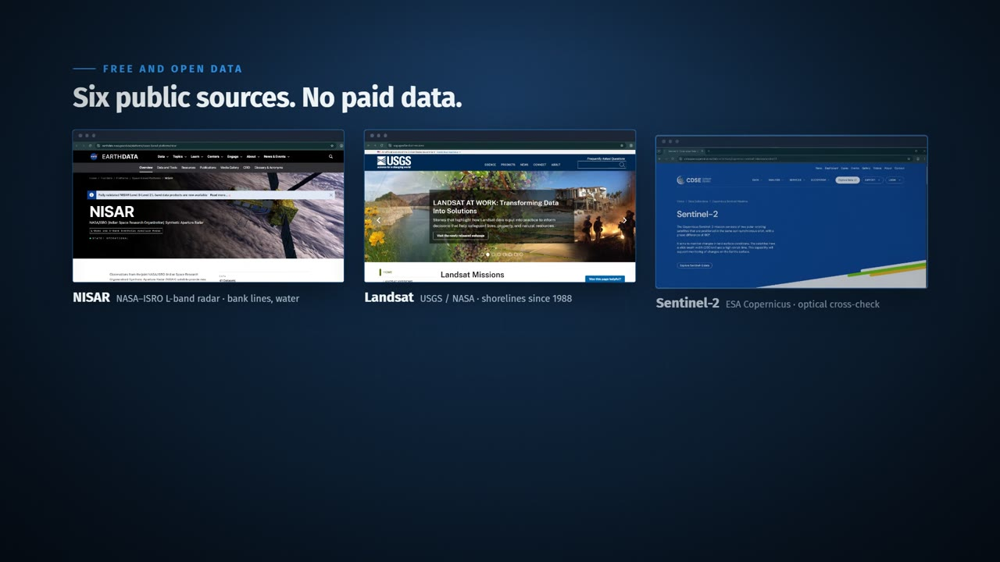
</p>

Only free and open data, no paid sources:

| Source | Used for |
|---|---|
| **NISAR** (NASA–ISRO), via ASF DAAC | Water, today's bank line, flood frequency (provisional 2026 products) |
| **Landsat** (USGS), via Planetary Computer | Bank lines every year since 1988 |
| **Sentinel-2** (Copernicus), via Planetary Computer | Checking the water maps |
| **OpenStreetMap** | Buildings, roads, facilities |
| **WorldPop** | People per pixel, Bangladesh 100 m estimates |
| **geoBoundaries** | Union boundaries |

Plus insights from previous research on Monpura Island (*Dhaka Univ. J. Biol. Sci.*, 2013). Full credits and licences are at the
[bottom of this page](#data-credits).

## Tech stack

| Layer | Built with |
|---|---|
| Processing pipeline | Python · numpy · xarray · rioxarray · rasterio · geopandas |
| API | FastAPI |
| Web app | React 18 · TypeScript · Vite · MapLibre GL · Terra Draw |
| Delivery | Docker · docker-compose · Render (API) · Vercel / GitHub Pages (web) · optional fully static edition |
| Tests | pytest · vitest · Playwright |

## Quick start

Try it on the synthetic demo site, with no accounts or downloads.

```bash
make setup     # conda env + npm install
make demo      # build the synthetic demo site
make api       # API on http://localhost:8000/api/v1/health
make web       # app on http://localhost:5173/map?site=demo
```

<details>
<summary><b>Quick start in detail: conda, Docker, or plain Python (Windows)</b></summary>

With conda and make (Linux/macOS/WSL):

```bash
make setup     # conda env `lsh` from environment.yml + npm install in web/
make demo      # synthetic demo site -> data/processed/demo
make api       # API on http://localhost:8000/api/v1/health
make web       # app on http://localhost:5173/ (home page) · map: http://localhost:5173/map?site=demo
```

With Docker only:

```bash
make demo      # or: python -m pipeline.cli all --site demo   (needs the Python env once)
make up        # docker compose: API + web (nginx) -> http://localhost:8080/map?site=demo
make down
```

Without conda/make (e.g. Windows, Python 3.11–3.12, Node 20+):

```bash
python -m venv .venv
.venv/Scripts/python -m pip install -r requirements.txt          # .venv/bin/python on Linux/macOS
.venv/Scripts/python -m pipeline.cli all --site demo
.venv/Scripts/python -m uvicorn api.app.main:app --reload       # http://localhost:8000
cd web && npm install && npm run dev                            # http://localhost:5173/map?site=demo
```

Tests: `make test` (pytest + vitest), `make lint` (ruff + eslint), `make e2e` (Playwright starts the API and the
built app itself; first run `cd web && npx playwright install chromium`).

Pages: `/` home page · `/map` the map · `/method` how it works + live validation · `/about` ·
`/report?site=&lon=&lat=` (or `&polygon=`) printable report — use the browser's "Save as PDF".

</details>

## Go further

<details>
<summary><b>Real data for a site (NASA Earthdata login, NISAR, Landsat)</b></summary>

1. Copy `.env.example` to `.env` and fill in your **NASA Earthdata** login. Never commit `.env` or `data/`.
   ASF only serves NISAR once (a) the **Study Area** field of your Earthdata profile
   (https://urs.earthdata.nasa.gov/profile) is filled in and (b) the ASF data application is authorized; the
   pipeline stops with the link if not.
2. Search NISAR and look at the inventory (no download):
   `make inventory SITE=manpura` → `data/raw/manpura/nisar/inventory.csv`. If more than one track has
   ≥ 6 usable passes, the step stops: set `nisar.track` in `config/sites/<site>.yaml`.
3. Download: `make fetch SITE=manpura` — NISAR **AOI subsets** read over HTTP range requests (~0.6–1 GB kept,
   ~35 min; `--full` downloads whole 6 GB files and refuses more than 20 GB unless confirmed), Landsat
   composites from Planetary Computer, OSM buildings, WorldPop and union boundaries.
4. Process: `make pipeline SITE=manpura` (gcov → water-sar → landsat → banklines → transects → flood → motion →
   context → score → validate → publish), or one step with `STEP=`. Steps skip outputs that exist (`--force`
   redoes them). Each writes a summary to `data/processed/<site>/summaries/<step>.json`.
5. Optional accuracy check: `python -m pipeline.cli validate --site manpura --make-points`, label the 200 points
   in `data/raw/manpura/validation/points.csv` (`water`/`land`) from Sentinel-2, run `validate` again.

</details>

<details>
<summary><b>Adding a new site</b></summary>

1. Create `config/sites/<id>.yaml` by copying `manpura.yaml` and change: `id`, `name.en` / `name.bn`, `aoi_wkt`
   (a lon/lat polygon, keep it under ~0.35° × 0.35°), `utm_epsg` (UTM zone of the AOI: 32645 west of 90°E, 32646
   east of it in Bangladesh), `center`, `zoom`, and `nisar.track: null`. Remove `validation.published_area_km2`
   unless you have published land areas for the site (then also list `validation.island_unions`).
2. Check it parses: `python -m pipeline.cli show-config --site <id>`.
3. Run steps 2–4 of "Real data" above with `SITE=<id>`; choose the track with the most HH passes covering the
   whole AOI (`aoi_cover` = 1 in the inventory).
4. Add the id to `SITES` in `.env` (and in the API's environment when deployed). The site appears in the site
   selector once its `layers.json` exists.
5. Check the sanity limits: rates within ±200 m/yr, ≥ 80 % of transects with a
   rate, score not all one class, water mask vs Sentinel-2 (`validation.json`).

</details>

<details>
<summary><b>Deploying: API, web, and the static edition</b></summary>

The API serves files from `data/processed/`, which is not in git. `make pack` (or
`python -m pipeline.lsh.pack --sites manpura,koyra,demo --tar data/deploy/lsh-data.tar.gz`) writes a deploy
copy with only the served files — radar dB layers rounded to 0.1 dB, the unused HV layer left out — and **fails
over 1.5 GB**. Manpura packs to ~300 MB.

**API (Render, Docker web service, `render.yaml`)**

1. Upload `data/deploy/lsh-data.tar.gz` somewhere public, e.g. as an asset of a GitHub release (`data-v1`).
2. In Render: *New → Blueprint* on this repository. Set `DATA_URL` (the archive's URL) and `CORS_ORIGINS`
   (the web app's origin). The image downloads the data at build time; health check `/api/v1/health`.
   Memory: ~260 MB with Manpura + demo loaded (measured); the free tier has 512 MB, so load fewer `SITES` if a
   third site does not fit.
3. Or build locally with the data baked in: `make build-api` (Docker with BuildKit), push the image to a
   registry and deploy that image (Render, Railway, Fly.io…).

**Web (Vercel, `vercel.json`)**: import the repository (root directory = repo root), set the environment
variable `VITE_API_URL=https://<api-host>/api/v1`, deploy. **GitHub Pages** instead: set the repository
variable `API_URL=https://<api-host>` and run the `pages` workflow by hand (it builds under `/<repo>/` and adds the
SPA fallback). Free API tiers sleep: the app pings `/health` first and says "Waking up the server…".

**Static edition (no API at all)**: `make static` writes `data/static/` (API-shaped JSON, pre-rendered PNG tiles
for zoom 8–14, and every site's point answers on a ~100 m grid, made by the API's own code) and builds
`web/dist-static/` with it inside — ~30 MB for Manpura + demo. Host that folder anywhere static (with the SPA
fallback). Clicks are answered for the ~100 m grid cell (the card says so); the radar backscatter layer, area
statistics and the NISAR scene search need the live API and say so. Useful as a fallback when the API host is
down or asleep.

</details>


## Repository layout

`config/sites/` site files · `pipeline/` offline Python processing (`python -m pipeline.cli <step> --site <id>`)
· `api/` FastAPI backend (+ `Dockerfile`) · `web/` React + MapLibre app (+ `Dockerfile`, nginx config) ·
`docs/METHOD.md` (+ `METHOD.bn.md`) the method in plain words, shown on `/method` ·
`docker-compose.yml`, `render.yaml`, `vercel.json` deployment.

```
config/sites/   site files                 pipeline/   offline Python processing
api/            FastAPI backend            web/        React + MapLibre app
docs/           method, features, media    docs/media/ story frames, screenshots, team photos
```

## Limitations

- NISAR products are **provisional** (first data 17 June 2026; validated products planned for the end of 2026);
  no data 27 July – 10 August 2026 (instrument gap).
- Monsoon radar maps flooded fields and wet mud as water. Bank lines use only NISAR water near the dry-season
  river, but today's bank still sits ~50–80 m inland of a Sentinel-2 outline at Manpura (different tide, wet
  mud), so "years until the river" errs on the early side.
- "Years until the river arrives" extrapolates the 1988–2026 average retreat rate; rivers change course. The range
  is only the statistical spread of that rate.
- Ground movement (InSAR) is unusable over wet, vegetated deltas (Manpura: 0.2 % coherent land) and is then left
  out of the score.
- People and building counts come from WorldPop and OpenStreetMap, which miss homes.
- The water maps are not yet checked against hand-labelled points (`validation.json` says so; see step 5 of “Real data for a site”).
- Bangla text still needs a native speaker's review.

Details and numbers: `/method` in the app and [docs/METHOD.md](docs/METHOD.md).

## Team

<table>
  <tr>
    <td align="center" width="25%"><br><b>Pritom Banik</b><br>Team Leader<br><sub>Project Management</sub></td>
    <td align="center" width="25%"><br><b>Arka Braja Prasad Nath</b><br>Lead Developer<br><sub>Technical Architect</sub></td>
    <td align="center" width="25%"><br><b>Megha Tania</b><br>UI/UX Designer<br><sub>Presenter</sub></td>
    <td align="center" width="25%"><br><b>Md Enam E Elahi</b><br>Researcher<br><sub>Data Analyst</sub></td>
  </tr>
</table>

## Project documents

| | |
|---|---|
| [docs/FEATURES.md](docs/FEATURES.md) | All 16 screenshots, with real-life uses |
| [docs/METHOD.md](docs/METHOD.md) · [বাংলা](docs/METHOD.bn.md) | How every number is calculated |

## Data credits

- NISAR data courtesy of NASA/JPL-Caltech and ISRO, via ASF DAAC (provisional `PR` products, 2026).
- Landsat data courtesy of the U.S. Geological Survey (Collection 2 Level 2), accessed through Microsoft
  Planetary Computer.
- Sentinel-2 (validation only): contains modified Copernicus Sentinel data 2026, via Microsoft Planetary Computer.
- Buildings, roads and facilities © OpenStreetMap contributors (ODbL), via the Overpass API. Basemap © OpenStreetMap
  contributors; satellite basemap © Esri, Maxar, Earthstar Geographics.
- Population: WorldPop (www.worldpop.org), Bangladesh 100 m constrained estimates 2025 (R2025A), CC BY 4.0.
- Union boundaries: geoBoundaries (Runfola et al. 2020), source Bangladesh Bureau of Statistics / OCHA ROAP,
  CC BY 3.0 IGO.

This project is not endorsed by NASA or ISRO. The NASA Space Apps Challenge logo appears in the film and the thumbnail only to name the event the project was built for; no NASA or ISRO insignia is used in the app.

## Licence

[MIT](LICENSE) · Built for NASA Space Apps Challenge 2026.
