# Features, screenshot by screenshot

What each part of The Last Safe Home does and who uses it. Back to the [README](../README.md).

All screenshots show **real data** for Manpura Island and Koyra (NISAR 2026 + Landsat 1988–2026), except where
marked as the demo site. They are made by `web/e2e/screenshots.manual.spec.ts` (see the file for how to refresh
them) and live in [`screenshots/`](screenshots/).

### 1. Site overview: Home Risk Score, water and bank lines

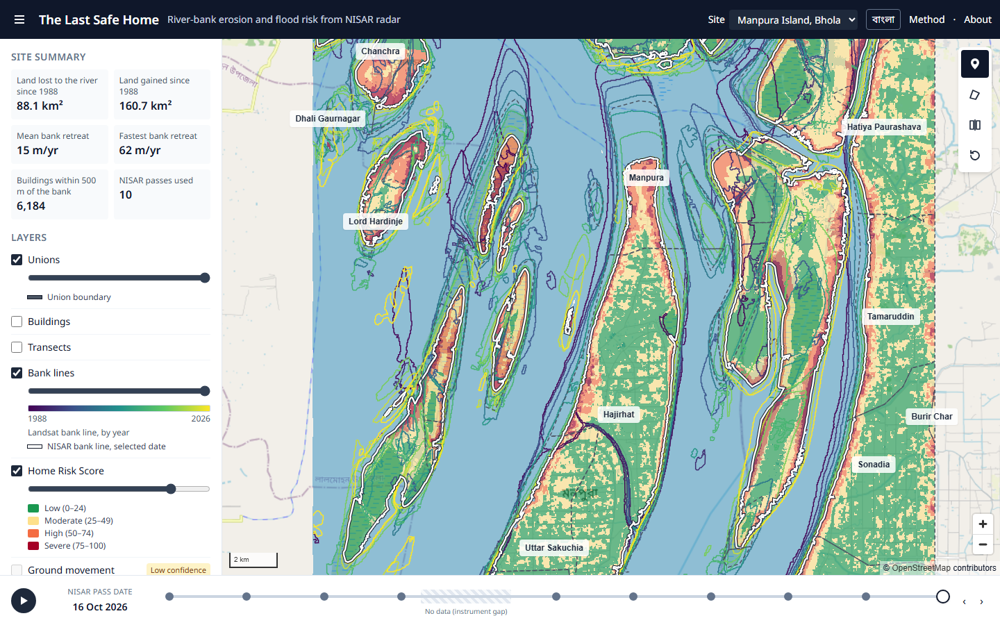

The map colours every piece of land by its **Home Risk Score** (green low → dark red severe), shows the water of
the selected NISAR pass in blue, and draws the river bank of every Landsat year since 1988 (purple → yellow) and
today's NISAR bank (white). The side panel sums up the site: land lost and gained since 1988, mean and fastest
bank retreat, buildings within 500 m of the bank, NISAR passes used.
**Real-life use:** a union parishad member or an NGO field officer sees at a glance which shores are eating into
villages and where the land is growing, before planning a visit or a meeting.

### 2. Point card: "When could the river reach this house?"

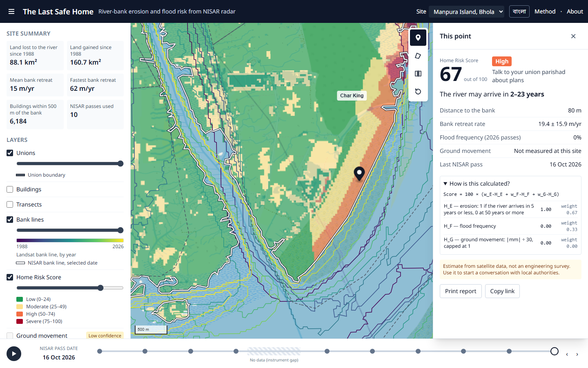

Click any point: its score (0–100) and class with plain advice, the estimated **range of years until the river
arrives**, the distance to today's bank, the bank's retreat rate (± its uncertainty), how often the spot flooded in
2026, and "How is this calculated?" with the formula and its parts. Every card carries the disclaimer.
**Real-life use:** a family deciding whether to rebuild on the same plot, or a local official checking a school or
cyclone shelter site, gets a number and a time range they can bring to the union parishad — "Copy link" shares
exactly this view.

### 3. Draw an area: statistics and NISAR scenes

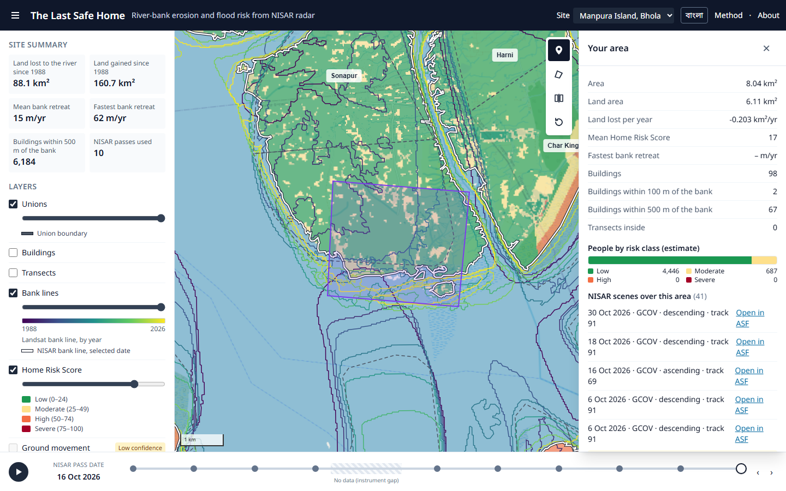

Draw any shape: area and land area, land lost per year, mean score, buildings (total, within 100 m and 500 m of the
bank), **people by risk class** (WorldPop estimate), transects inside, and a live list of the NISAR scenes over the
area with "Open in ASF" links. The shape can be downloaded as GeoJSON.
**Real-life use:** a relief or resettlement planner outlines a ward or a char and gets how many homes and people
sit near a retreating bank; a researcher finds which NISAR radar scenes cover their study area.

### 4. Radar image and time slider

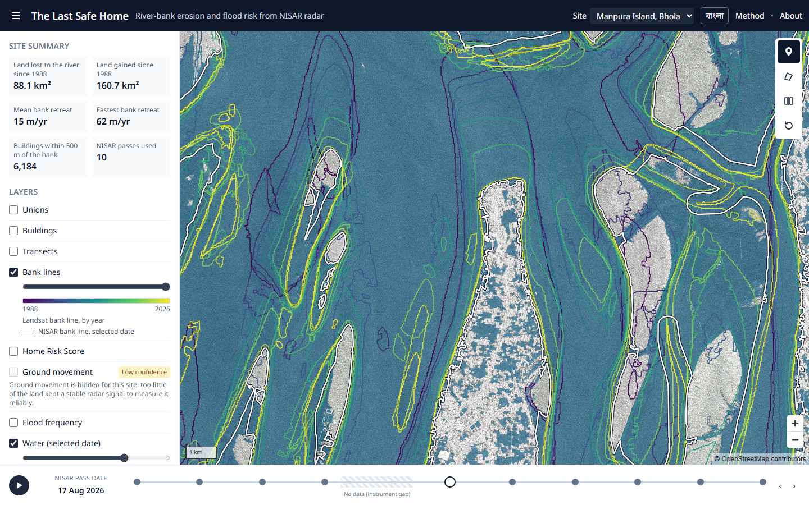

The NISAR radar image (HH backscatter: water dark, land bright) for any 2026 pass, with that day's water. The
slider steps through the passes (play, arrow keys); the July–August instrument gap is marked.
**Real-life use:** watch the monsoon flood spread and drain pass by pass, through clouds that block ordinary
satellite photos — useful for disaster-management staff after heavy rain or a cyclone.

### 5. Flood frequency

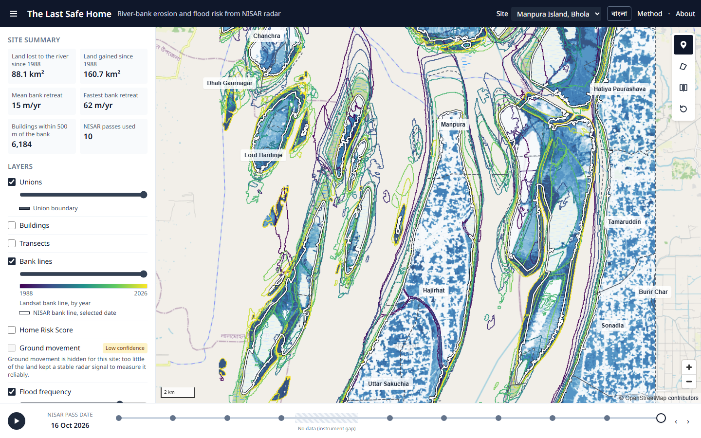

How often each place was under water across the 2026 NISAR passes (light = rarely, dark blue = almost always).
**Real-life use:** shows which fields, roads and homesteads flood repeatedly in the monsoon — where raised plinths,
embankment repair or drainage would help most.

### 6. Transects: how fast each stretch of bank moves

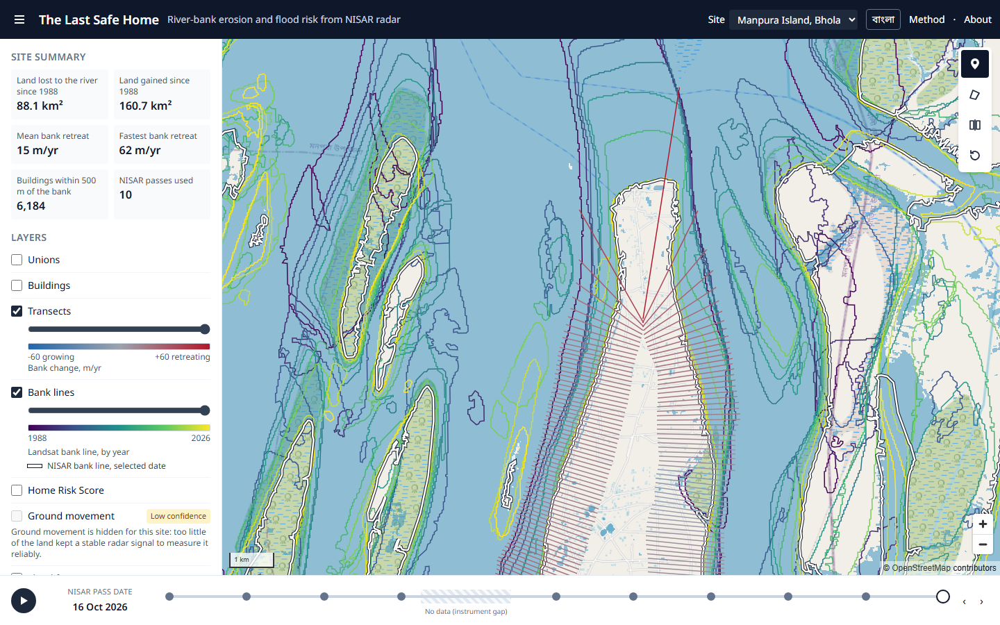

Lines every 100 m across the bank, coloured by the bank's speed since 1988 (red = retreating, blue = growing,
± 60 m/yr). The retreat rates drive the "years until the river arrives".
**Real-life use:** engineers and the Water Development Board can see which stretches erode fastest and compare them
with where protection works exist.

### 7. Compare 1988 with today

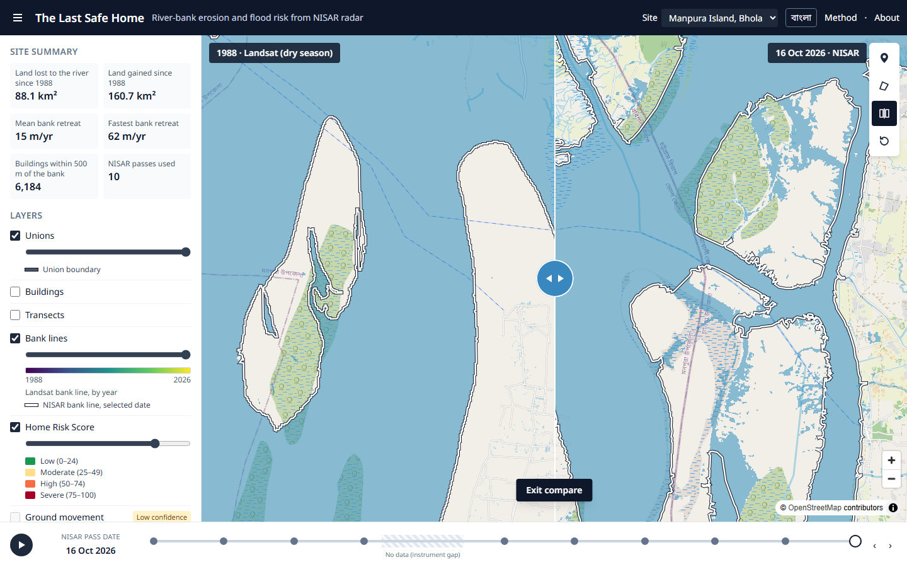

Drag the handle (or use the arrow keys) to swipe between the 1988 dry-season shoreline (Landsat) and the latest
NISAR shoreline.
**Real-life use:** the clearest way to show a community meeting, a journalist or a donor how much land has gone in
one generation.

### 8. Union statistics

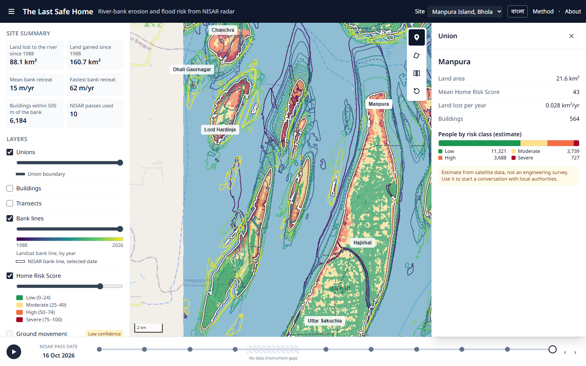

Click a union name: land area, mean score, land lost per year, buildings and people by risk class.
**Real-life use:** union and upazila officials compare their unions to set priorities for a budget or an
adaptation plan.

### 9. Bangla

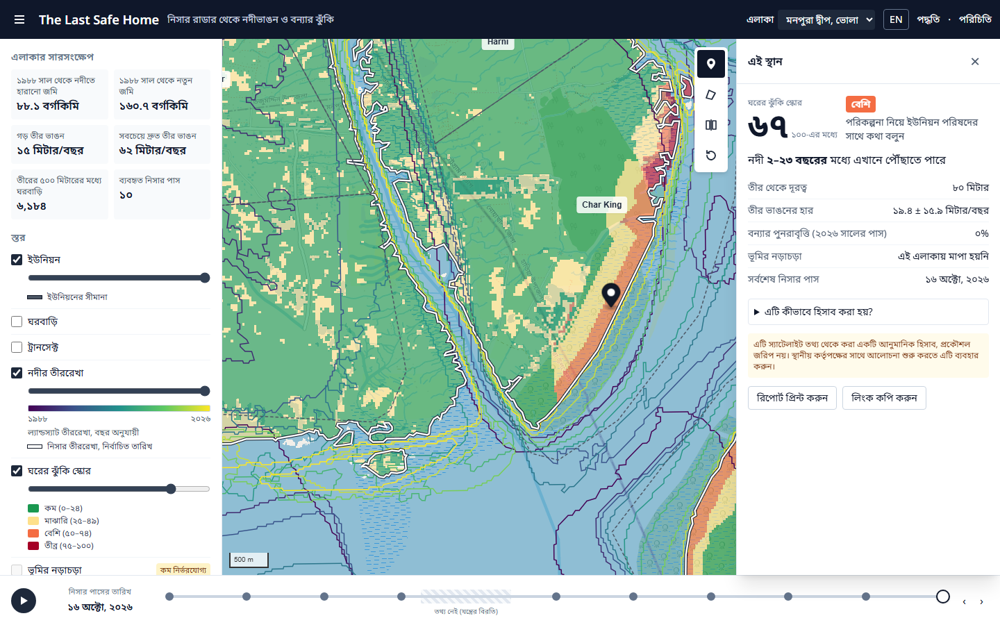

Every label, number and date switches to Bangla (বাংলা) with one button; the language stays in the link.
**Real-life use:** people on the char and local officials read the results in their own language.

### 10. Printable report

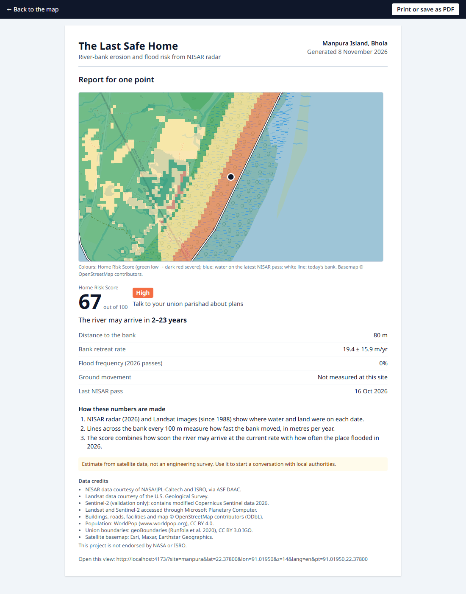

"Print report" opens an A4 page — map, the numbers, a three-line method summary, the disclaimer, data credits and a
link back to the view — to print or save as PDF (Bangla prints correctly).
**Real-life use:** take a paper copy to the union parishad, attach it to a relocation request, or hand it out at a
community meeting where there is no internet.

### 11. Method and live validation

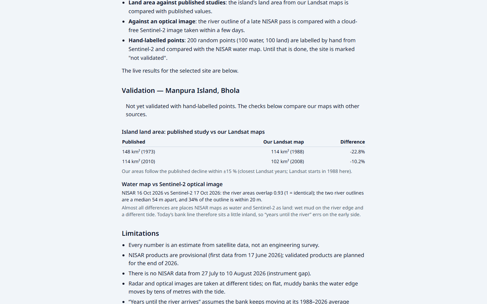

How everything is calculated, in plain words (English and Bangla), with the site's live validation numbers
(land area vs a published study, water map vs a Sentinel-2 image), the limitations and the data credits.
**Real-life use:** lets a reviewer, journalist or official judge how far to trust the numbers before acting on them.

### 12. About

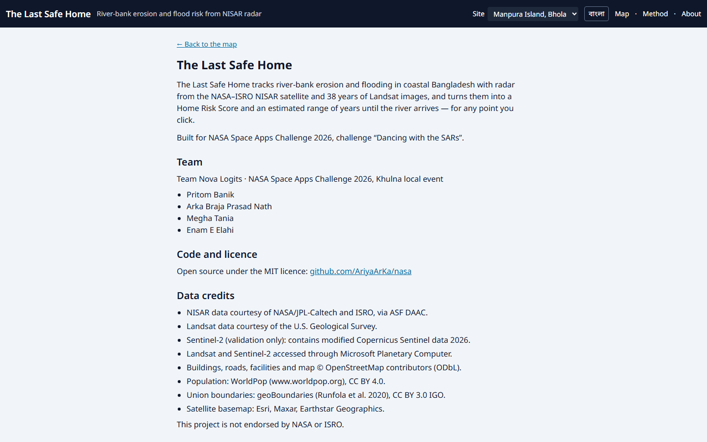

What the project is, the team, the licence and repository link, and the data credits.

### 13. Second site: Koyra, Khulna

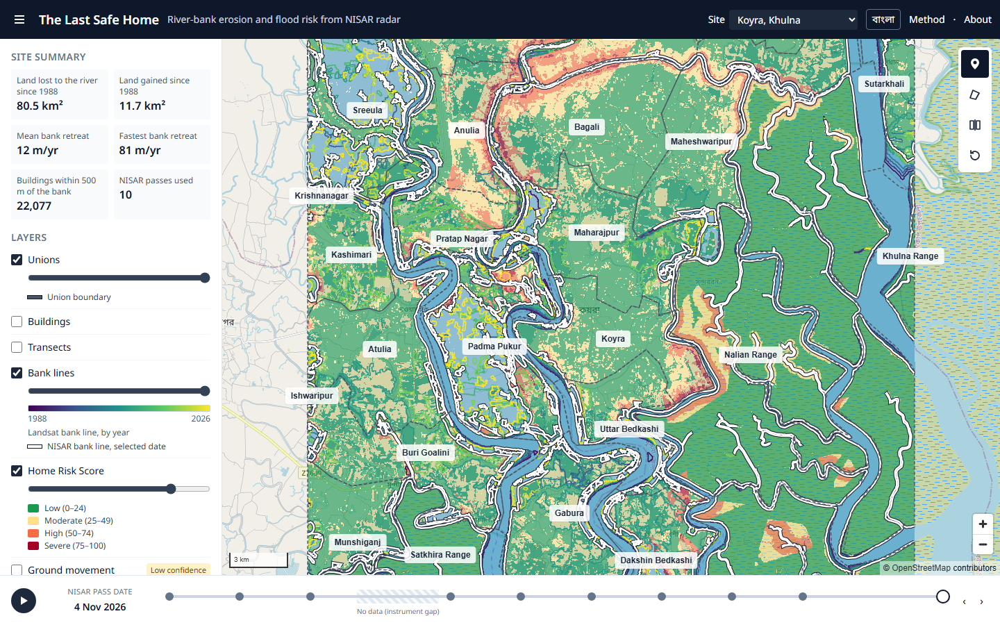

The same analysis for Koyra on the edge of the Sundarbans (NISAR track 170). New sites are added with one config
file (see "Adding a new site").

### 14. Demo site (no downloads)

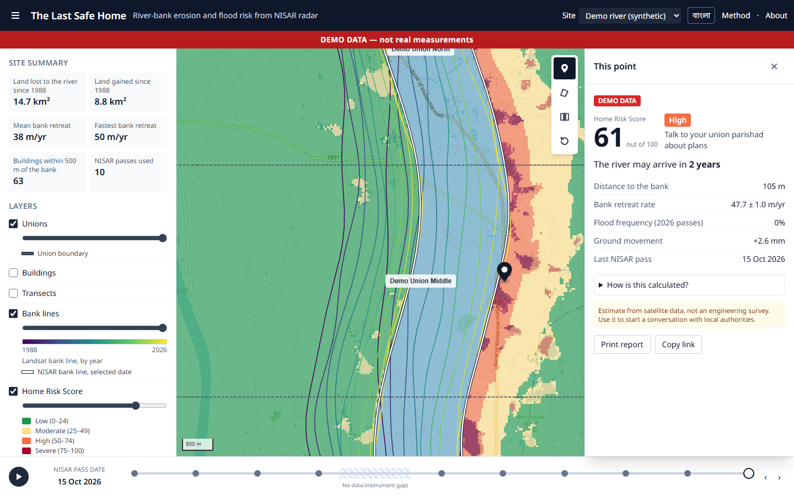

A synthetic river that makes the whole app work without any downloads or logins — for trying the app, teaching and
tests. A red "DEMO DATA — not real measurements" banner is always shown.

### 15–16. Phones

  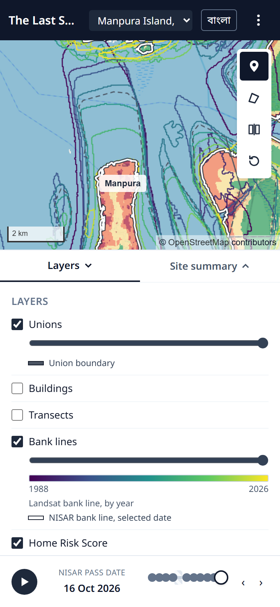
  &nbsp;
  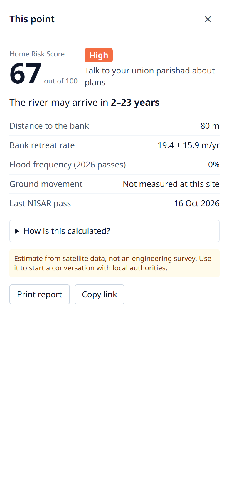

On phones the side panel becomes a bottom sheet (Layers · Site summary) and the point card fills the screen.
**Real-life use:** most people in coastal Bangladesh are online by mobile phone — the app works on a phone in the
field, standing on the bank itself.
